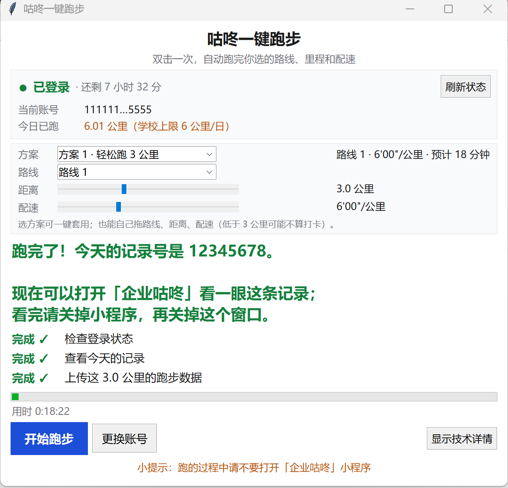
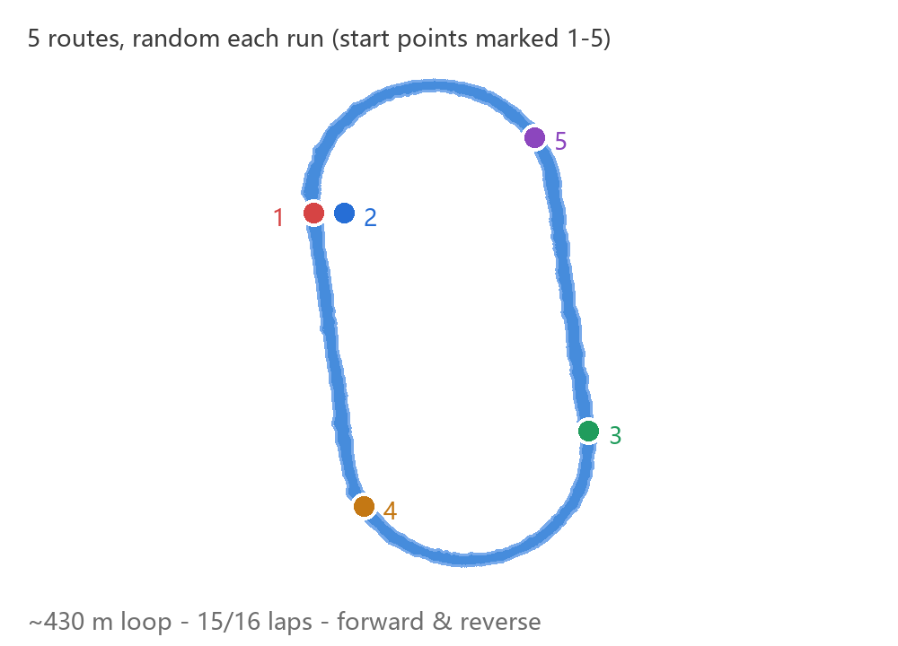

# 咕咚一键跑步（gdty-fake-run）

浙大体艺 / 企业咕咚（咕咚校园跑）的**协议级**打卡工具：不依赖手机、不改定位、不需要 root / 越狱，直接伪造小程序上传的 GPS 轨迹与步数。

Windows 提供图形界面（双击即跑）；macOS 使用同套 Python 核心 + 命令行脚本。

> ⚠️ **风险自负**：刷跑属于违反学校规定的作弊行为，被认定通常体育成绩作废。本项目仅用于网络安全与小程序协议的学习研究。
>
> 仓库里**不包含**任何人的账号配置、token、证书私钥和运行日志。所有个人数据都需要自己抓包生成。

---

## 功能

- **图形界面**（`run_now.pyw`）：显示登录状态、当前账号、今日里程；**10 个方案预设 + 自定义路线/距离/配速**；一键跑步；登录过期时一键重登；**一键更换账号**（分步引导切微信账号并自动同步配置）
- 界面可选 **1–6.5 km** 和 **4'00"–10'00"/km**；**要计满学校的 6 km，请选「方案 5 · 6.5 公里」或自定义 ≥6 km**
- **10 条路线**，可按方案指定；反着常规方向跑的会标「（反向）」；每场的配速基准、步幅、速度波动节奏、中途减速时间点都随机微调
- **海拔/爬升模拟**：基线 50 m，按里程铺 1~3 段 10~14 m 的缓坡（坡间回落到基准线）；平台会丢弃 8 m 以内的小起伏，6.5 km 服务端约 24 m，短距离相应减少
- 跑完自动生成并挂载轨迹图（腾讯地图瓦片 + 蓝线 + 起点/终点）
- token 快过期自动续期

## 截图

主界面（示例数据）：



路线示意（校园跑道环线；10 条路线共用同一条跑道，区别是起点、方向、圈数）：



## 环境要求

| 平台 | 依赖 |
|---|---|
| Windows 10/11 | Python 3.10+、桌面微信、`pip install -r requirements.txt` |
| macOS | Python 3、`brew install mitmproxy cliclick`、`pip3 install pillow` |

`requirements.txt` 只有两个包：`mitmproxy`（抓 token）和 `pillow`（画轨迹图）。
装好后确认 `mitmdump -h` 能运行；如果提示找不到，请把 Python 的 `Scripts` 目录加进 PATH。

## 快速开始（Windows）

1. 复制配置模板（**先不用填 ID**）：
   ```powershell
   copy config.example.json config.json
   ```
   第一次登录成功后，程序会自动把 `user_id`、`club_id` 写进 `config.json`。
2. 生成并信任 mitmproxy 证书（只需一次，仅当前用户，无需管理员）：
   ```powershell
   powershell -ExecutionPolicy Bypass -File .\refresh.ps1 -GenCaOnly
   certutil -user -addstore -f ROOT mitmca\mitmproxy-ca-cert.cer
   ```
3. 双击 `run_now.pyw`（建议用 `pythonw.exe` 建桌面快捷方式，不弹黑框）。
   第一次打开会提示登录：按界面指引，在**桌面微信**里打开一次「企业咕咚」小程序，2 分钟内自动抓取。
4. 抓完后把小程序关掉，回到界面选方案（**要计满 6 km 选「方案 5 · 6.5 公里」**），再点「开始跑步」。
5. 看一眼 `config.json`：`user_id` / `club_id` 应该已经被自动填上；没有就再抓一次。

> 手动兜底：`user_id` 就是 `token.txt` 里 JWT 的 `sub`；`club_id` 会自动记录在 `captured_params.json`。
> 如果 `club_id` 没抓到，跑步本身不受影响，只是界面的「今日已跑」会显示查询失败。

### 首次部署检查清单

- [ ] `pip install -r requirements.txt` 成功
- [ ] `mitmdump -h` 能运行（不在 PATH 就加进 PATH）
- [ ] 证书已导入「当前用户 → 受信任的根证书颁发机构」
- [ ] 桌面微信已登录，能打开「企业咕咚」小程序
- [ ] `python forge2.py --dry` 能输出坐标，且坐标在**你学校**范围内（只读，不上传）
- [ ] 界面顶部显示「已登录」后再点「开始跑步」

### 更换账号

点界面上的「更换账号」，按提示操作：

1. 微信左下角「☰」→「切换账号」（没有就「退出登录」再登录新微信号）
2. 回来点「开始抓取新账号」
3. 2 分钟内到微信打开一次「企业咕咚」小程序

抓取成功后会自动把新账号的 `user_id`（以及能抓到的 `club_id`）写进 `config.json`；抓取失败不会影响原来的账号。
如果新账号属于别的学校，还需要换路线文件（`route_*.json`）。

> 旧版命令行入口 `run_now.ps1` 未包含在本仓库，图形界面已覆盖全部功能。

## 目录结构

| 文件 | 作用 |
|---|---|
| `run_now.pyw` | 图形界面主程序（双击运行） |
| `forge2.py` | 核心：合成轨迹并实时提交（`--dry` 只预览不上传） |
| `route_1.json` … `route_10.json` | 10 条路线（可在界面选，也可由 `route_templates` 随机抽） |
| `route_template.json` | 默认路线（没有配置 `route_templates` 时使用） |
| `route_img.py` | 轨迹图生成 + OSS 直传 + 挂载 |
| `token_grab.py` | mitmproxy 插件，截获登录 token |
| `refresh.ps1` / `refresh.sh` | 一键续期（临时开代理 → 抓 token → 恢复代理） |
| `daily_checkin.ps1` / `daily_checkin.sh` | 每日自动入口（防重、随机延时、按需续期、提交） |
| `check_status.py` | 状态查询：token 剩余 / 今天是否已跑 / 今日里程 |
| `captured_params.json` | 抓包时自动生成的账号参数（已 gitignore，不要提交） |
| `unpack.js` | wxapkg 解包器（研究协议用，可选） |
| `tests/test_step_reporting.py` | 离线回归测试（不联网、不需要配置） |

> `config.json`、`token.txt`、`captured_params.json`、`mitmca/` 都是**个人数据**，已被 `.gitignore` 排除。

## 配置说明（`config.json`）

| 字段 | 含义 |
|---|---|
| `user_id` | 咕咚用户 UUID，**首次登录后自动填写** |
| `club_id` | 学校/俱乐部编号，**抓包时自动填写**（抓不到不影响跑步） |
| `appid` | 小程序 appid，默认 `wx2961574bbec73239` |
| `route_templates` | 路线文件列表，每次随机选一条；缺省回退到 `route_template` |
| `route_template` | 默认路线文件 |
| `target_m` | 命令行默认里程（米），默认 6500；**界面选方案会覆盖它** |
| `base_pace` / `pace_min` / `pace_max` | 配速基准 / 下限 / 上限（秒/公里） |
| `min_record_m` | 防重阈值：当天已有 ≥ 该里程的记录就跳过（默认 3000） |
| `device_info` / `brand` | 设备指纹，保持默认即可 |

## 每日自动（可选）

Windows 任务计划程序：

```powershell
schtasks /create /tn "gdty-checkin" /tr "powershell -ExecutionPolicy Bypass -File C:\path\to\daily_checkin.ps1" /sc daily /st 14:00
```

`daily_checkin.ps1` 会：检查 token → 不足 2 小时先续期（需要有人打开一次小程序）→ 今日已有记录则跳过 → 随机延时 1~36 分钟 → 提交。

macOS 用 `refresh.sh` / `daily_checkin.sh`，交给 cron / launchd 触发。

## macOS（命令行）

图形界面只支持 Windows；macOS 用同一套 Python 核心：

1. `brew install mitmproxy`，并信任 `mitmca/mitmproxy-ca-cert.pem`（`security add-trusted-cert`）
2. `./refresh.sh`：临时开代理，按提示在微信打开一次小程序
3. 手动把 `token.txt` 里 JWT 的 `sub` 填进 `config.json` 的 `user_id`；`club_id` 从 `captured_params.json` 取
4. `python3 forge2.py --dry` 自检，`python3 -u forge2.py` 正式跑

## 换成你们学校的路线

仓库自带的是**深圳某校区跑道环线**（约 430 m，15/16 圈）。其他学校的用户直接跑会落在错误位置，**必须先换路线**：

1. 先真实跑一次（自己或同学）
2. 调用 detail 接口拿坐标：
   `GET /v1/open/get_user_gps_info/detail?route_id=<真实记录ID>`，取响应里的 `point_list_view`
3. 导出成 `[[lat, lon], ...]`，保存为 `route_1.json`（格式同现有文件）；要多条就复制并反向/换起点
4. 只保留一条也可以：把 `config.json` 的 `route_templates` 改成 `["route_1.json"]`
5. `python forge2.py --dry` 确认坐标落在你学校

## 反检测红线（不要“优化”）

这些取值经过服务端实测，改动可能导致点位被静默丢弃或标记作弊：

1. `distance` 是**本段位移**（8~16 m），不是累计里程
2. `h_accuracy` 恒为 0；`v_accuracy` 是 ≈3.0 的浮点
3. 必须带 `"gyroscope": ""`；普通点 `type`=0、首点=1、收尾点=5
4. 点间隔 **3~7 秒随机**（精确 1 Hz 是机器人指纹）
5. 必须**实时**提交，跑多久挂多久
6. 坐标噪声单位是**米**，换算需除以 111320（纬）/ 85200（经）
7. 步幅随配速自适应：跑步约 **1.45~1.58 m/步**，走/慢跑约 **0.75~1.2 m/步**（步频约 120~200 spm）；`create_route_gyroscope_steps` 的 `cur_steps` 是**本间隔增量**，不是累计值
8. `location` 是**字符串**（空串）；GET 接口要带 `club_id`

其他纪律：每天最多 1 条有效记录；不要每天固定同一时刻；`completes_route` 返回 `route_id: 0` 是**失败**。

## 故障排查

| 症状 | 处理 |
|---|---|
| 完成时报「数据太少」 | 点位被服务端丢弃：检查时间戳抖动与批量随机性 |
| 详情页地图空白 | 点位指纹不对，核对上面第 1~3 条 |
| 列表里没有新记录 | 完成响应 `route_id` 为 0，重试 `completes_route` |
| token 401 | 已过期，点「重新登录」并在微信打开一次小程序 |
| 小程序转圈 | 代理指向了已退出的 mitmdump：关掉系统代理后重试 |
| 换号提示「还是原来的账号」 | 微信没切过去，或打开小程序时仍是旧账号 |

## 免责声明

本项目仅用于网络安全与小程序协议研究学习，请勿用于任何违反校规或法律的用途。使用者因使用本工具产生的一切后果自负。
